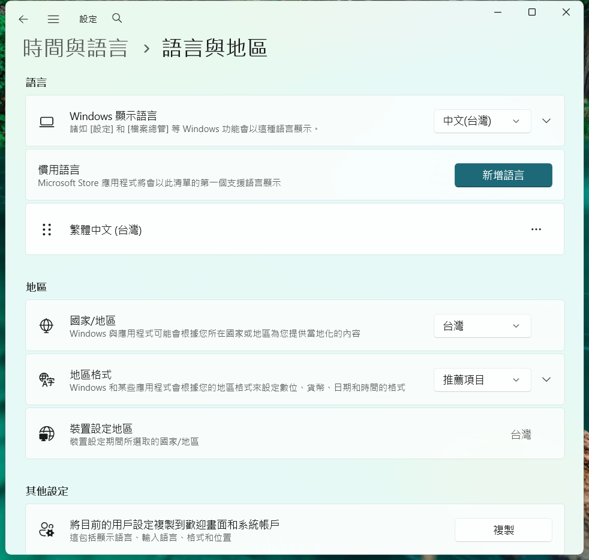
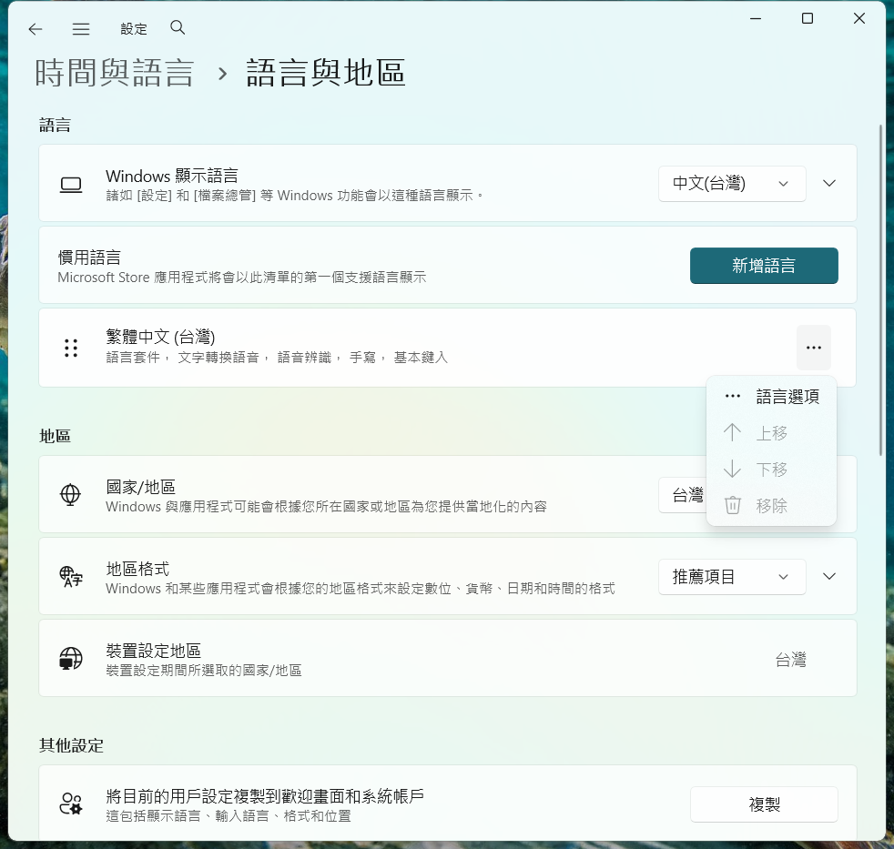
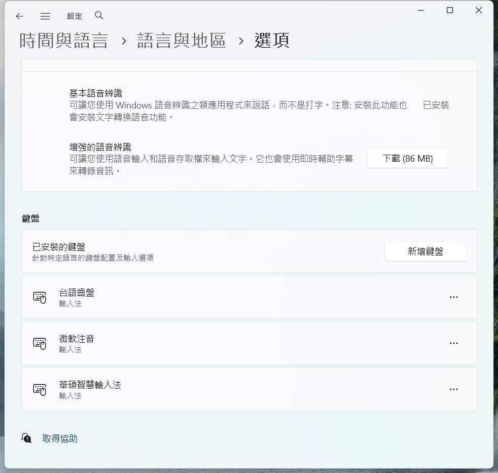

# Installation screenshots

Real desktop captures of TaigiKeyboard **3.8.0**, taken on 2026-10-25 and 2026-10-26.
Files are grouped by platform and locale (`en`, `zh-TW`, `ja`).
Localized step captions are in [captions.json](captions.json).
Website and browser download steps are excluded; captures start at installation
or the operating system’s security prompts.

## macOS

Captured on macOS 27.0.1 (Apple silicon), using the published, signed and notarized
`.pkg`. Installer and System Settings use their native English, Traditional Chinese
and Japanese interfaces.

| Step | English | Traditional Chinese | Japanese |
| --- | --- | --- | --- |
| Installer introduction | [Image](macos/en/01-introduction.png) | [Image](macos/zh-TW/01-introduction.png) | [Image](macos/ja/01-introduction.png) |
| Destination (optional) | [Image](macos/en/02-destination.png) | [Image](macos/zh-TW/02-destination.png) | [Image](macos/ja/02-destination.png) |
| Installation type | [Image](macos/en/03-installation-type.png) | [Image](macos/zh-TW/03-installation-type.png) | [Image](macos/ja/03-installation-type.png) |
| Installation in progress | [Image](macos/en/04-progress.png) | [Image](macos/zh-TW/04-progress.png) | [Image](macos/ja/04-progress.png) |
| Installation complete | [Image](macos/en/05-result.png) | [Image](macos/zh-TW/05-result.png) | [Image](macos/ja/05-result.png) |
| Keep or discard the installer | [Image](macos/en/06-close.png) | [Image](macos/zh-TW/06-close.png) | [Image](macos/ja/06-close.png) |
| Keyboard settings | [Image](macos/en/07-keyboard-settings.png) | [Image](macos/zh-TW/07-keyboard-settings.png) | [Image](macos/ja/07-keyboard-settings.png) |
| Input Sources → Edit | [Image](macos/en/08-input-sources.png) | [Image](macos/zh-TW/08-input-sources.png) | [Image](macos/ja/08-input-sources.png) |
| Find and select the input source | [Image](macos/en/09-find-source.png) | [Image](macos/zh-TW/09-find-source.png) | [Image](macos/ja/09-find-source.png) |
| Input source added | [Image](macos/en/10-source-added.png) | [Image](macos/zh-TW/10-source-added.png) | [Image](macos/ja/10-source-added.png) |

1. Open the macOS package. Click Continue, then Install.
   Installation is for the current user, inside `~/Library/Input Methods`.
   These captures completed without an administrator password or a Gatekeeper
   blocking prompt. Destination Select normally advances automatically; the
   optional destination screen was opened through Change Install Location.
2. Close the successful installer. Choose Keep to retain the downloaded package,
   or Move to Trash to discard it.
3. Open System Settings → Keyboard → Text Input → Input Sources → Edit, then +.
   Search `taigi` in English, `台語` in Traditional Chinese, or `台湾語` in Japanese.
   Select Multiple languages, then TaigiKeyboard and Add. The input method is
   named `台語齒盤` in Traditional Chinese and `台湾語キーボード` in Japanese.
   The category names in the captured picker remain English in all three locales.
4. Confirm the input source appears in the list and click Done. Select it from
   the menu bar's input menu. The host menu remains English; the common
   [input-menu screenshot](macos/en/11-switch-source.png) shows TaigiKeyboard.

These captures come from a configured development Mac. Settings images include
only the relevant pane or dialog to exclude account information. The original
development application and input preferences were preserved and restored after
capture. No logout was needed on this Mac; on a first installation, sign out and
back in if the new input method is not listed.

## Windows

Captured on Windows 11 x64. The installer was run separately with its native
English, Traditional Chinese, and Japanese translations.

| Step | English | Traditional Chinese | Japanese |
| --- | --- | --- | --- |
| SmartScreen: app blocked | [Image](windows/en/smartscreen-block.png) | [Image](windows/zh-TW/smartscreen-block.png) | [Image](windows/ja/smartscreen-block.png) |
| SmartScreen: More info | [Image](windows/en/smartscreen-more-info.png) | [Image](windows/zh-TW/smartscreen-more-info.png) | [Image](windows/ja/smartscreen-more-info.png) |

Open the Windows installer. On SmartScreen, choose **More info →
Run anyway**. Windows then asks for administrator approval through UAC.
UAC secure-desktop screenshots are intentionally omitted. Approve the prompt
on the computer to continue installation.

After UAC approval, the installer opens directly at Ready to Install:

| Step | English | Traditional Chinese | Japanese |
| --- | --- | --- | --- |
| Ready to install | [Image](windows/en/01-ready.png) | [Image](windows/zh-TW/01-ready.png) | [Image](windows/ja/01-ready.png) |
| Installation in progress | [Image](windows/en/02-installing.png) | [Image](windows/zh-TW/02-installing.png) | [Image](windows/ja/02-installing.png) |
| Installation complete | [Image](windows/en/03-complete.png) | [Image](windows/zh-TW/03-complete.png) | [Image](windows/ja/03-complete.png) |

After installation, find the keyboard in **Settings → Time & language →
Language & region → Chinese (Traditional, Taiwan) → Language options →
Keyboards → Installed keyboards**. Windows 11 Settings and keyboard-menu captures
are available in English, Traditional Chinese, and Japanese:

| Step | English | Traditional Chinese | Japanese |
| --- | --- | --- | --- |
| Language & region | [Image](windows/en/04-language-region.png) | [Image](windows/zh-TW/04-language-region.png) | [Image](windows/ja/04-language-region.png) |
| Language options menu | [Image](windows/en/05-language-options-menu.png) | [Image](windows/zh-TW/05-language-options-menu.png) | [Image](windows/ja/05-language-options-menu.png) |
| Installed keyboards | [Image](windows/en/06-keyboard-installed.png) | [Image](windows/zh-TW/06-keyboard-installed.png) | [Image](windows/ja/06-keyboard-installed.png) |
| Switch input method | [Image](windows/en/07-switch-input-method.png) | [Image](windows/zh-TW/07-switch-input-method.png) | [Image](windows/ja/07-switch-input-method.png) |

1. Open Settings → Time & language → Language & region. Find Chinese
   (Traditional, Taiwan) under Preferred languages; add the language if missing.

   

2. Click the three-dot menu beside Chinese (Traditional, Taiwan), then choose
   Language options.

   

3. Scroll down to Keyboards → Installed keyboards and look for TaigiKeyboard.
   If it is missing, click Add a keyboard and select TaigiKeyboard.

   

Sign out and back in if the newly installed input method is not listed.
Press Windows + Space to switch input methods.

These pictures come from a configured development machine and do not represent
a clean Windows account. The installer already registered the input method, so
no manual Add a keyboard picker was needed. Windows 10 and Edge-specific
browser warnings are not represented by these Windows 11/Chrome captures.

## Linux

Captured on Ubuntu 24.04 x86_64, KDE Plasma (X11), **Fcitx5**. The terminal and
configuration tool use the corresponding locale's actual translations.

Some shared buttons in the Traditional Chinese configuration tool retain their
upstream English labels (for example, Apply); the captions follow the visible UI.

| Step | English | Traditional Chinese | Japanese |
| --- | --- | --- | --- |
| Install the downloaded package | [Image](linux/en/01-install-command.png) | [Image](linux/zh-TW/01-install-command.png) | [Image](linux/ja/01-install-command.png) |
| Package installation complete | [Image](linux/en/02-package-installed.png) | [Image](linux/zh-TW/02-package-installed.png) | [Image](linux/ja/02-package-installed.png) |
| Find the input method | [Image](linux/en/04-find-input-method.png) | [Image](linux/zh-TW/04-find-input-method.png) | [Image](linux/ja/04-find-input-method.png) |
| Select the input method | [Image](linux/en/05-select-input-method.png) | [Image](linux/zh-TW/05-select-input-method.png) | [Image](linux/ja/05-select-input-method.png) |
| Input method added | [Image](linux/en/06-input-method-added.png) | [Image](linux/zh-TW/06-input-method-added.png) | [Image](linux/ja/06-input-method-added.png) |

Open a terminal in the `.deb` package directory and run the command pictured. The `-y` option
accepts the package manager's confirmation. Restart Fcitx5 (`fcitx5 -rd`) or sign
out and back in, then open Fcitx Configuration. Clear Only Show Current Language,
search for `taigi`, select the input method, click the left arrow, and click Apply.

The package was removed and installed again for each locale; user settings and
learning data were retained. These are not clean-system dependency-installation
screenshots. Fedora, Arch, GNOME/IBus, and graphical package installers are not
represented by the Ubuntu/Fcitx5 pictures.

## Package verification

Captures use the published release files, checked against their release `.sha256` files:

| File | SHA-256 |
| --- | --- |
| `TaigiKeyboard-3.8.0.pkg` | `d9454cd7933a702eb68c17b06ff1e6e407de5cf65b2c4379f458c5e1d606f43a` |
| `TaigiKeyboard-3.8.0.exe` | `48ea85fa7f89558e1ba54b123b2feca0416ef93309f8ef87ed359c63671a3b67` |
| `taigikeyboard_3.8.0_amd64.deb` | `4fcdeb91bfd3583d271ebf276f7991e90f352ed806dc2133b1eefe656e1511e9` |

Only window, pane, dialog and input-menu captures are included. Capture scripts, desktop dumps, development
package captures, and machine-specific logs are excluded.
